# Technical Design Document — Pharmacy Chain Online Reordering with Pharmacist Prescription Checks

**GitHub repository:** https://github.com/Ujjwal5705/pharmacy-reordering 
**Live app URL:** none. The prototype is local/demo only and was not deployed (see [deployment.md](../deployment.md)). 
**Problem statement:** Problem 3 — pharmacy chain online reordering with pharmacist prescription checks 
**Author:** Ujjwal Sharma · **Date:** 2 November 2026 · **Status:** working prototype on synthetic data

> Every person, phone number, clinic, prescription and order in the prototype is fictional. Payments and messaging are test-mode mocks. The prototype is **not** legally compliant or production-ready. Regulatory behaviour implements only what the brief states, and every assumption is labelled **[A#]**.

---

## 1. Executive summary

Company A (46 stores in Kolkata and Howrah, plus a central warehouse) loses repeat customers when nobody reminds them to refill or the store is out of stock. Today, orders arrive by phone and WhatsApp and the prescriptions sit on store phones. This prototype replaces that with one web application:

- **Customers and caregivers** sign in with an OTP, pick the family member they are ordering for, reorder last month’s medicines in one tap (or search the catalogue), upload a prescription and pay in test mode. They then track the order and opt in to refill reminders.
- **Every prescription item is checked by a registered pharmacist.** An automated reader (local OCR by default) drafts the medicines, strengths and dosages with per-field confidence. The pharmacist sees this draft beside the original image, corrects it, and approves, rejects or requests a re-upload item by item. The automation never approves anything.
- **Orders route to the nearest store that has every item in stock**, based on a daily stock CSV. Stock is reserved transactionally, so the last units cannot be oversold. Stores pick, pack (recording the store invoice number) and hand over. Operations sees orders by store, verification time, rejections and orders waiting for stock.
- **Safety rules are configurable but bounded:** Schedule X and narcotic items can never be sold online, Schedule H/H1 cannot be dispatched without pharmacist approval, and H1 supplies need a register entry. Each rule is enforced in code and again in the database, and each is covered by automated tests.

**Core scope delivered (brief’s required slice):** customer reorder journey with prescription upload, pharmacist verification queue and review, store routing on available stock, and refill reminders. Store fulfilment, the operations dashboard, stock CSV import and versioned medicine rules were added once the core worked.

| Result | Value |
|---|---|
| Screens | login + 7 customer · 2 pharmacist · 1 store · 3 operations (all backed by the database) |
| Automated tests | **155 Vitest tests passed** (104 unit + 51 PostgreSQL integration) and **5 Playwright browser journeys passed** |
| Verified from a fresh clone | install → migrate → seed → production build → full journey → all test suites |

---

## 2. Architecture

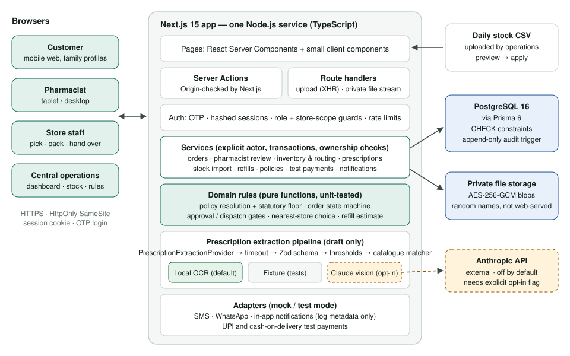

**One deployable Next.js 15 service (TypeScript) and one PostgreSQL 16 database.** I chose this because:

1. **Fit for a seven-day solo build.** Server components, server actions and two route handlers cover the UI and API without a separate backend to keep in sync.
2. **The safety logic is the product.** It lives in plain TypeScript modules, not in UI code:
   - `src/server/domain/` holds pure functions: policy resolution, the order state machine, the approval/dispatch gates, nearest-store choice and the refill estimate.
   - `src/server/services/` holds use cases. Every service function takes an explicit `actor` and checks role, store scope and ownership itself, so these rules hold whichever page or action calls them, and the tests call the services directly.
3. **PostgreSQL gives correctness for free where it matters:**
   - Transactions and row locks prevent overselling.
   - CHECK constraints form a second line of defence: stock cannot go negative or below reservations, and the statutory policy floor is enforced.
   - A trigger makes the audit table append-only.
4. **No microservices or queues.** The brief does not need them. Extraction runs inline with a timeout (about 0.6 s for local OCR on the fixtures), which keeps behaviour deterministic and testable.

**Key libraries:** Prisma 6 (schema, migrations), Zod 4 (all input validation), Tailwind CSS 4 (design tokens), tesseract.js 7 (local OCR, WASM, English model bundled), `@anthropic-ai/sdk` (optional vision adapter), Vitest and Playwright.

---

## 3. Data model

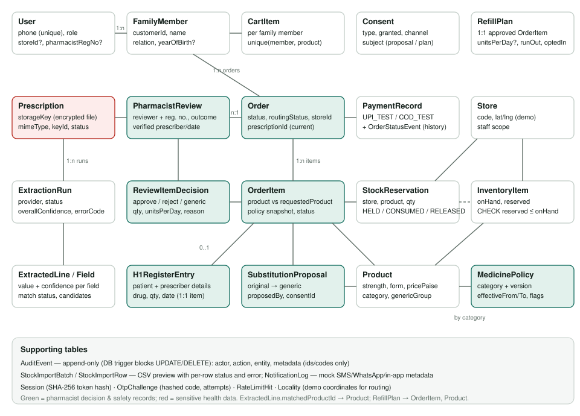

| Entity | Why it exists / important rules |
|---|---|
| `User`, `FamilyMember` | One login per customer. Patients are family members, each with their own cart, prescriptions and reminders. Staff carry `role`, an optional `storeId` (store scope) and `pharmacistRegNo`. Only accounts with a registration number can make prescription decisions. |
| `Product`, `MedicinePolicy` | Products have strength, form, pack size, price in **integer paise**, schedule `category`, a `genericGroup` (equivalent brand/generic products) and a `refillReminders` catalogue flag for repeat medicines. Policies are **versioned and effective-dated per category**: `onlineOrderable`, `prescriptionRequired`, `pharmacistApprovalRequired`, `h1RegisterRequired`. |
| `Store`, `Locality`, `InventoryItem`, `StockReservation`, `StockImportBatch/Row` | `onHand` and `reserved` per store and product (`CHECK 0 ≤ reserved ≤ onHand`). Reservations are HELD → CONSUMED (at packing) or RELEASED (reject/cancel/reduce). Each CSV import keeps every row with its status for the preview and history. |
| `Order`, `OrderItem`, `OrderStatusEvent`, `PaymentRecord` | Order status and routing status are separate. Items snapshot the policy applied at submission and keep `requestedProductId` so a substitution is always visible. Every transition writes a status event. Payments are test records only. |
| `Prescription`, `ExtractionRun`, `ExtractedLine`, `ExtractedField` | The file is an encrypted blob under a random key; the database holds only metadata. Each extraction run stores provider, status, overall confidence and per-field value plus confidence, but never the raw OCR text. |
| `PharmacistReview`, `ReviewItemDecision`, `H1RegisterEntry` | Who decided what, with which registration number, against which prescription and AI draft. Holds the verified prescriber and date, plus the H1 register (patient and prescriber details, drug, quantity, date) linked one-to-one to the item. |
| `SubstitutionProposal`, `Consent` | A generic proposal records the proposing pharmacist; the customer’s answer is a `Consent` record (with wording version). Refill reminder opt-ins are also consents. |
| `RefillPlan`, `NotificationLog` | Created only for pharmacist-approved items whose product is marked for refill reminders. Dates are calculated only from pharmacist-confirmed units per day. Notifications are mock logs that hold only an order number or plan ID. |
| `AuditEvent` | Append-only (database trigger). Records file views, decisions, policy changes, transitions, stock imports, logins and access denials. Metadata holds IDs and codes only. |
| `Session`, `OtpChallenge`, `RateLimitHit` | Tokens and codes are stored only as hashes. Rate limits live in Postgres, so they work across instances. |

---

## 4. Main end-to-end flow

1. **Sign in.** The customer enters a mobile number and the 6-digit code. Sessions use an HttpOnly, SameSite=Lax cookie (Secure in production) and the database stores only a SHA-256 of the token. Code requests are rate-limited per number and per client, and each code allows 5 verification attempts.
2. **Choose patient and items.** The “Ordering for” selector is always visible. The home page offers **Reorder monthly medicines**, which copies the last order’s supplied items into that patient’s cart (nothing is submitted). Reminders offer the same one tap per medicine. Catalogue search shows schedule badges and availability near the customer’s area. Blocked categories show *Not sold online* with no add button, and the server refuses them too.
3. **Prescription.** At checkout the customer re-uses a prescription on file or uploads a new one (JPEG/PNG/PDF ≤ 8 MB) with a real progress bar. The server:
   1. checks the file’s signature, extension, declared type and size;
   2. encrypts it with AES-256-GCM into private storage;
   3. runs the extraction pipeline;
   4. stores the draft and audits both the upload and the run.

   The customer sees the draft, per-line confidence, and whether each cart item appears on the prescription. If the draft is unreadable or low-confidence, they are asked for a clearer photo, and can send it for manual reading only after confirming they understand it may be delayed.
4. **Submit and route.** The order is created as `AWAITING_PHARMACIST` (or `APPROVED` if it has no prescription items). Routing then tries stores in distance order, reserving every line in one transaction per store. The first store that can supply everything wins. If none can, the order is marked **NO_STOCK** (never split) and operations sees it.
5. **Pharmacist review.** The queue is oldest first, shows waiting time against the 10-minute target, and flags manual-read and H1 orders. The review screen shows the original image (zoom/rotate), the draft with confidence, and pre-filled editable verified fields. The pharmacist decides each item (approve with quantity and dosage as written / propose a generic / reject with a reason), or puts the whole order on hold for re-upload or rejects it. The approval gate is checked inside the same transaction.
6. **Store fulfilment.** Pick → pack (store invoice number; reserved stock is consumed) → hand over (who collected) → delivered. The dispatch gate is re-evaluated at every step against the *live* policy.
7. **Tracking and refills.** The customer sees a timeline, the pharmacist’s reasons, consent requests and the assigned store. On delivery each approved repeat medicine gets an estimated run-out date of *delivery date + ⌊units supplied ÷ units per day⌋*. Opted-in plans produce an in-app reminder (and a mock SMS/WhatsApp entry from the reminder job) a configurable number of days before.

---

## 5. Order state machine, medicine policy and hard safety invariants

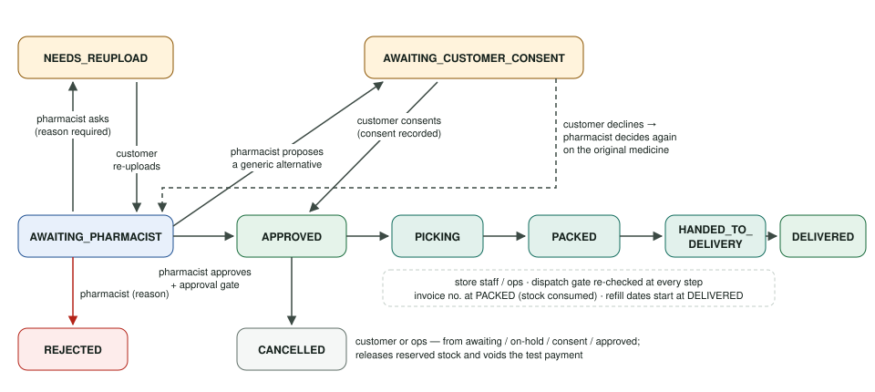

Orders start in `AWAITING_PHARMACIST` when any item needs a pharmacist, or in `APPROVED` when they contain only non-prescription items. `ORDER_TRANSITIONS` in `src/server/domain/order-state.ts` lists every legal move and the roles allowed to make it. Transitions run through `transitionOrder()`, which:

- re-asserts the rule;
- uses a compare-and-set update (`WHERE status = from`) so concurrent clicks cannot double-apply;
- writes a status event and an audit event.

**Medicine policy.** `resolvePolicy()` picks the highest version whose effective window contains “now”; if no rule is active, the category **fails closed** (not orderable). `decidePolicy()` then applies a statutory floor taken from the brief, so a configured rule can be stricter but never looser:

- Schedule X and narcotic items are never online;
- Schedule H and H1 always need a prescription and pharmacist approval;
- H1 always needs the register.

The same floor is a database CHECK constraint on `MedicinePolicy`, so even a direct SQL insert cannot enable Schedule X online.

| # | Invariant | How it is enforced | Automated tests |
|---|---|---|---|
| 1 | Schedule X / narcotic blocked from cart, checkout, routing, dispatch | `decidePolicy` floor; checks in `addToCart`, `submitOrder`, `routeOrder`, dispatch gate (live policy); DB CHECK on policies | unit `policy`, `gates`; integration “Schedule X and narcotic items are blocked online” (6 tests); e2e test 2 |
| 2 | Schedule H/H1 not dispatched without pharmacist approval | Approval and dispatch gates require `approvedByReviewId` from a review written by an active registered pharmacist, plus a prescription on the order; re-checked at pick, pack, hand-over and delivery | unit gates; integration “cannot be dispatched before pharmacist approval” (3 tests) |
| 3 | H1 register captured before dispatch | Review rejects H1 approval without register fields; gate requires `H1RegisterEntry` | integration “H1 register details” (2); e2e test 5 |
| 4 | AI never approves | Extraction output schema has no decision fields; only `submitReview` (pharmacist only) writes decisions; customers see “draft” wording | unit “output carries no decision fields”; integration “high-confidence extraction leaves every item pending” |
| 5 | Unreadable or low-confidence prescriptions cannot silently proceed | Pipeline thresholds → LOW_CONFIDENCE/UNREADABLE/FAILED; checkout requires explicit acknowledgement; order flagged `manualReviewRequired`; pharmacist can request re-upload | unit pipeline tests (9); integration low-confidence, provider-failure and re-upload loop; e2e test 3 |
| 6 | Generic substitution needs pharmacist approval and customer consent | Only a pharmacist can propose (same `genericGroup`, generic, orderable); the product changes only when the owning customer accepts (`Consent` record); the gate blocks any substituted item without an accepted pharmacist proposal and granted consent | integration (6 tests); e2e test 4 |
| 7 | Only authorised pharmacists can decide | `assertRegisteredPharmacist` + store scope (`canAccessStore`) | integration role matrix (customer, store, ops, unregistered, out-of-scope, signed-out) |
| 8 | Customers see only their own data; staff only their scope | Every query is scoped by `actor.id` or store; per-page role checks (layouts are not a security boundary); prescription files only for the owner or an in-scope pharmacist | integration ownership tests; e2e test 2 |
| 9 | No overselling; route only with sufficient stock | Conditional `UPDATE … WHERE onHand − reserved ≥ qty` per line inside a transaction; order claimed with compare-and-set; CHECK `reserved ≤ onHand` | integration: 5 concurrent orders for 3 units → exactly 3 routed; idempotent routing; DB refuses over-reservation |
| 10 | Refill reminders never create orders | Reminder job only writes notification logs; one-tap reorder only fills the cart | integration end-to-end flow (order and cart counts unchanged) |
| 11 | File views and sensitive actions audited | `readPrescriptionFile` audits each view and each denial; review, H1, consent, policy, transitions and imports audited; trigger blocks UPDATE/DELETE | integration audit tests |

---

## 6. Prescription AI/OCR design

**Interface.** A provider implements `PrescriptionExtractionProvider { name, external, supports(mime), extract(input, signal) }` and returns `RawExtraction`. That structure holds, for each medicine line, a value and a confidence for name, strength, dosage text, duration and quantity, plus header fields (patient, prescriber, registration number, clinic address, date). Each provider is told to return **null for anything not legible**.

| Provider | When | Data flow |
|---|---|---|
| `local-ocr` (**default**) | Tesseract (WASM) in the server process. A deterministic parser turns OCR lines into fields; each field’s confidence is the lowest word confidence it covers | Prescription never leaves the server |
| `anthropic` (opt-in) | Claude vision via the official SDK with structured outputs (Zod schema). Default model `claude-opus-5-5`, configurable | Sends the image or PDF to Anthropic; **only** if `EXTRACTION_PROVIDER=anthropic` **and** `ALLOW_EXTERNAL_PRESCRIPTION_PROCESSING=true` **and** a key is set. Otherwise every prescription goes to manual review |
| `fixture` | Automated tests and browser tests: returns the recorded transcription of a synthetic fixture by SHA-256 | Local |
| `none` | Extraction disabled | — |

**Pipeline (`runExtraction`).** It never throws: every failure becomes a status that sends the prescription to manual review.

1. **Unsupported format** (e.g. a PDF with local OCR) → `UNSUPPORTED`.
2. **Timeout** (`EXTRACTION_TIMEOUT_MS`, AbortController) → `FAILED/TIMEOUT`.
3. **Provider exception** → `FAILED/PROVIDER_ERROR`. A missing key or a disabled provider → `FAILED/NOT_CONFIGURED`.
4. **Re-validation** with a strict Zod schema (bounded confidences and lengths) → `FAILED/INVALID_RESPONSE` if it fails. This also covers malformed JSON from the LLM adapter, refusals and truncated outputs.
5. **No medicine lines** → `UNREADABLE` (“upload a clearer photo”).
6. **Low confidence.** Any missing name or strength, a field below `EXTRACTION_MIN_FIELD_CONFIDENCE` (0.80), or an overall score below `EXTRACTION_MIN_OVERALL_CONFIDENCE` (0.75) → `LOW_CONFIDENCE`. The thresholds are prototype assumptions **[A7]**.
7. **Dosage.** Only explicit notations (`1-0-1`, `OD/BD/TDS/QID`, “twice daily”) become units per day. Conflicting or absent notation stays null. Quantity is taken only when written. When dosage and duration are both written, a *calculated* quantity is shown, flagged as calculated, with its basis.
8. **Catalogue matching.** Normalised names (molecule and brand stem) are compared by bigram similarity, and strength must match exactly. Equivalent products (same `genericGroup`) count as one medicine; different medicines scoring within 0.10 stay **AMBIGUOUS**, as does a missing strength.

**Human review.** The pharmacist screen shows the original image next to every extracted value with a confidence badge (high / check / low / not legible, in words, not colour alone). Header fields are pre-filled but editable, and per-item dosage and units per day are editable. Nothing the automation produced changes an order: only the pharmacist’s submitted values are stored as decisions. Customers see the draft only as reassurance (“matches your cart”), and it never adds items to the cart.

**Measured behaviour on the synthetic fixtures (real Tesseract runs, not mocked):** the four printed fixtures were read as `SUCCEEDED` (overall confidence 0.91–0.92), with every medicine correctly matched and dosage parsed. “As directed” correctly produced no dose. The blurred handwriting-style fixture came back `UNREADABLE`, and a PDF came back `UNSUPPORTED` → manual review. Real handwritten prescriptions are expected to come back low-confidence from local OCR; that is the intended safe failure.

---

## 7. Security and privacy

- **Prescription files (sensitive under the DPDP Act 2023, per the brief).**
  - Encryption is AES-256-GCM via Node’s crypto; there is no custom cryptography. The key comes only from `PRESCRIPTION_ENCRYPTION_KEY` (generated locally by `setup:env`, never committed) and is labelled with a key ID for rotation.
  - The storage key is bound in as associated data, so a blob moved to another record fails to decrypt. The file is stored under a random 128-bit name outside any public directory, and path traversal is blocked by a strict name pattern.
  - Files are served only by a route handler that authorises each request: owner, or a pharmacist whose store scope covers an order using that prescription. Store staff and operations never see images.
  - Responses are streamed with `Cache-Control: no-store`, `nosniff`, a restrictive CSP and inline disposition. There is no permanent URL. Every view and every denial is audited: each display uses a fresh per-render URL so the browser cannot reuse an earlier copy without a logged request, and collapsed previews are only fetched when opened.
- **Authentication and sessions.** OTP codes are hashed per challenge, compared in constant time, single-use, expire after 5 minutes, and allow 5 attempts. Sessions are 32 random bytes stored as SHA-256. The demo OTP works only when `APP_ENV` is `demo` or `test`; `APP_ENV` defaults to `production` when unset, and startup **fails** if a demo OTP is configured with `APP_ENV=production`, so it cannot be enabled by accident.
- **Authorisation.** Every service takes an explicit actor and checks role, ownership and store scope. Every staff page also checks its role, because App Router layouts are not a security boundary. Wrong-role users see a permission-denied page.
- **CSRF and input.** Server actions are origin-checked by Next.js. The upload route rejects requests whose `Origin` does not match the host. Cookies are SameSite=Lax. All inputs are validated by Zod on the server, and schema errors are returned as readable validation messages.
- **Rate limits.** OTP requests (5 per number per 15 minutes, 30 per client per hour), OTP verification (50 per client per hour) and uploads (20 per customer per hour), stored in Postgres.
- **Logs and analytics.** Unexpected errors are logged as error class and code only: no payloads, OCR text or health data. Notification metadata holds an order number or plan ID only. There are no analytics.
- **Headers.** `X-Frame-Options: SAMEORIGIN`, `X-Content-Type-Options`, `Referrer-Policy`, `Permissions-Policy`; `X-Powered-By` removed.
- **Repository hygiene.** `.env`, storage, builds and ZIPs are git-ignored, and `.env.example` holds names with empty secrets. A scan of tracked files found no keys, tokens, real phone numbers or personal emails.

**Not done (would be needed before real use):** a security review or penetration test; a key-management service; consent and retention policies tied to the DPDP Act; data-subject access and deletion; backup encryption; WAF and bot protection; a real SMS provider.

---

## 8. UI and design decisions

Design direction from the brief: calm, minimal, trustworthy, large readable text, obvious family context, no promotional clutter.

- **Visual system.** Tailwind tokens: deep teal for primary actions; amber, red, blue and green reserved for status. 14 px card radius, 17–18 px base text in customer screens, minimum 44 px touch targets, visible focus rings, and reduced-motion support.
- **Customer (mobile first).** Bottom tab bar. The patient selector is always visible under the header (“Ordering for: Sunita Ghosh · Mother”). The home page leads with one large **Reorder monthly medicines** button. Warnings are written in full sentences, never hidden in tooltips: *prescription needed*, *not sold online*, *we couldn’t read this clearly*, *waiting for stock*, *your consent is needed*, *pharmacist approved*.
- **Pharmacist (desktop/tablet).** The review screen is two columns with the prescription viewer sticky. Confidence is shown in words and percentages next to each value. Decisions are large radio buttons, and the submit button stays disabled until every item has a decision. Consequences are spelled out, e.g. “the order will wait for the customer’s consent”.
- **States.** Every signed-in area has loading skeletons and an error boundary with retry. There are empty states, inline validation, toasts, an offline banner and a permission-denied page. The upload control stays disabled until it is interactive.
- **Languages.** Navigation, statuses, the demo banner and main buttons are available in English, Bengali and Hindi through a small dictionary with an English fallback; the Bengali and Hindi strings are drafts **[A10]**.

<table class="shots">
<tr>
<td>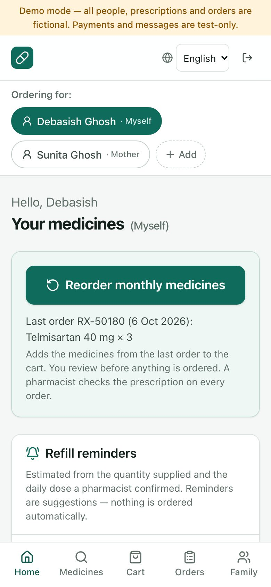 <em>Customer home: patient selector, one-tap reorder, refill reminder</em></td>
<td>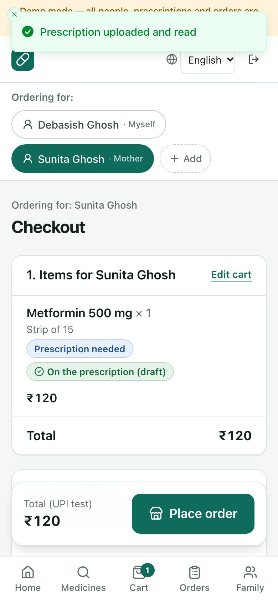 <em>Checkout: upload, automated draft vs cart, routing preview</em></td>
</tr>
<tr>
<td>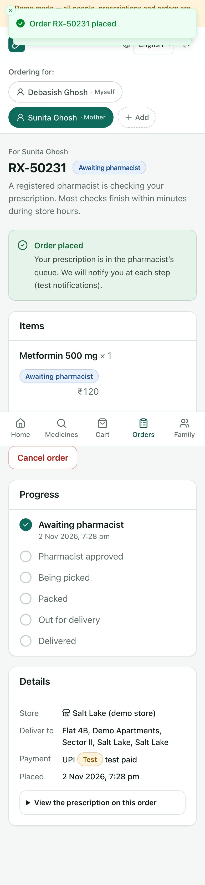 <em>Order placed and tracking</em></td>
<td>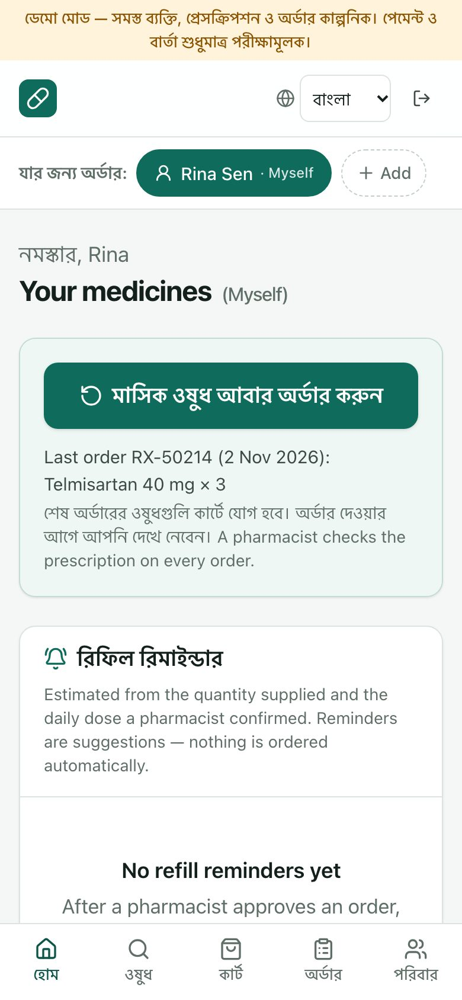 <em>Bengali navigation and calls to action</em></td>
</tr>
</table>

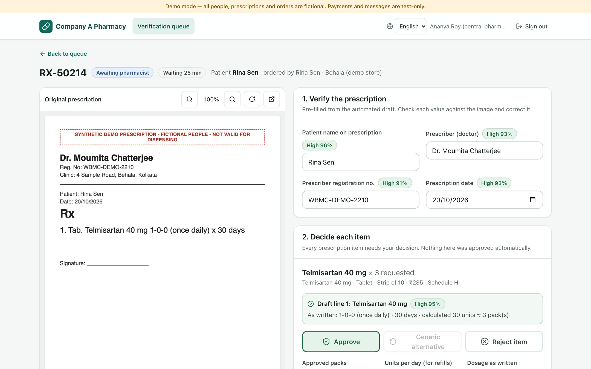
*Pharmacist review: original prescription beside verified fields and per-field confidence.*

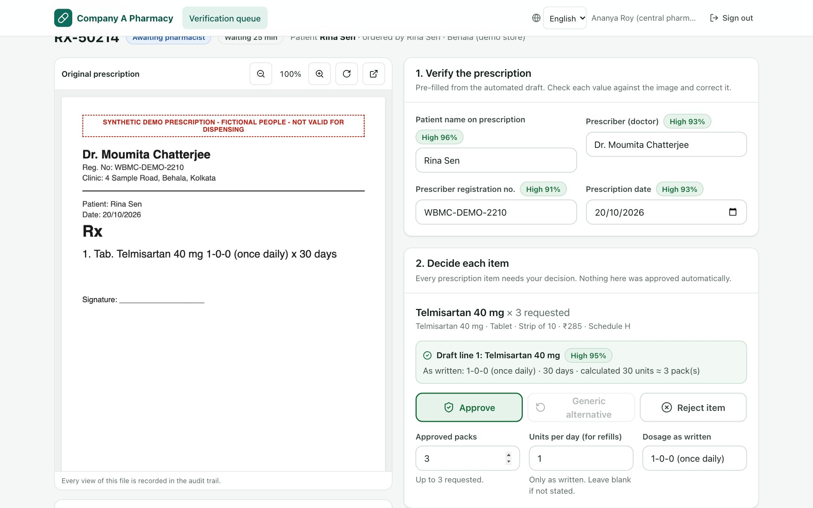
*Per-item decision with the draft line, calculated quantity and refill inputs.*

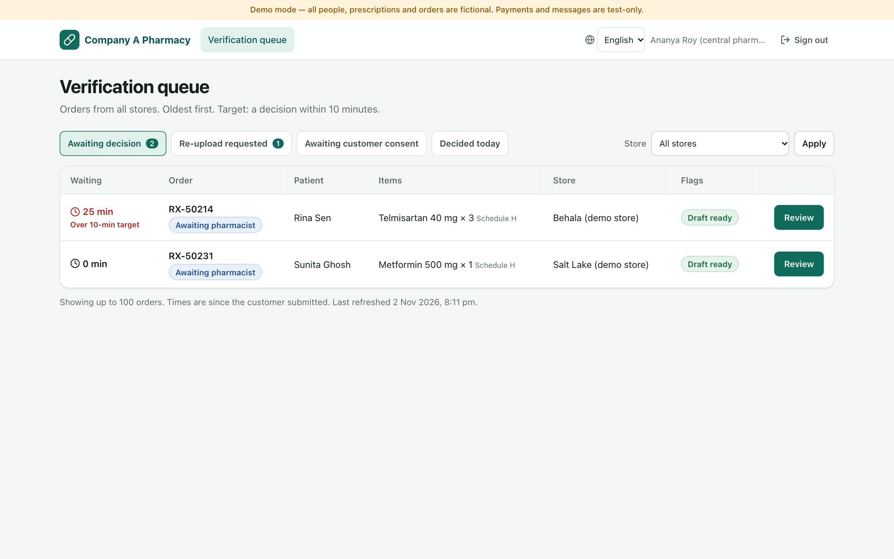
*Verification queue: waiting time, 10-minute target, flags.*

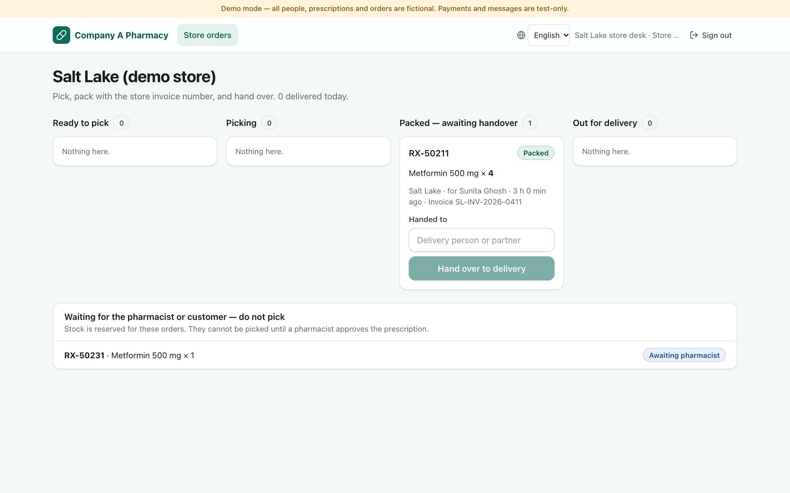
*Store board: pick → pack (invoice) → hand over → delivered.*

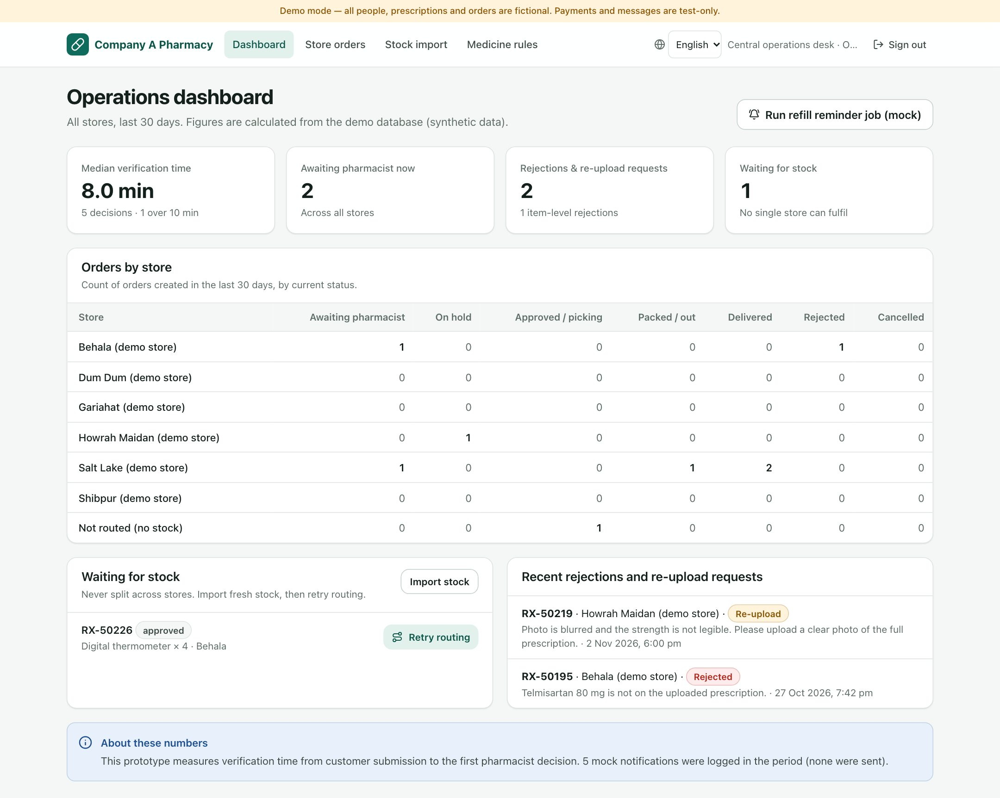
*Operations dashboard calculated from the synthetic demo database.*

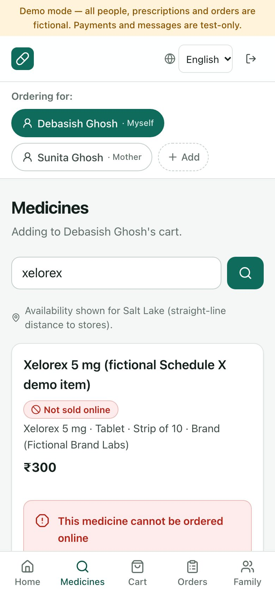
*A fictional Schedule X item shown as not sold online.*

---

## 9. Tests run and results

All results below are from real runs on the final code (2 Nov 2026, macOS, Node 22.17, PostgreSQL 16):

| Command | Result |
|---|---|
| `npm run typecheck` | exit 0 |
| `npm run lint` | exit 0 |
| `npm test` (Vitest) | **9 files, 155 tests passed, 0 failed** |
| `npm run test:e2e` (Playwright, Chromium) | **5 tests passed, 0 failed** |
| `npm run build` | production build succeeded |

| Suite | Tests | What it covers |
|---|---|---|
| `unit/policy` | 16 | schedule categories, statutory floor, fail-closed, versions and effective dates, draft validation |
| `unit/order-state-and-gates` | 17 | legal transitions per role, terminal states, approval and dispatch gate violations (H, H1, X, live policy change, substitution, stock) |
| `unit/refill-geo-csv` | 20 | refill maths and rounding, missing dosage, awaiting delivery; haversine and nearest *full* store (no splitting); CSV headers, row errors (raw bad value kept), duplicates, BOM |
| `unit/format` | 2 | customer-facing text helpers (reason punctuation, delivery address) |
| `unit/extraction` | 32 | dosage notations, OCR parsing with per-field confidence, no guessed values, catalogue matching (matched/ambiguous/unmatched), pipeline timeout, provider error, invalid output, unsupported, low confidence |
| `unit/security-primitives` | 17 | demo OTP impossible in production, external AI opt-in, mocked Claude adapter failures (refusal, truncation, invalid output, connection), AES-GCM tamper/wrong key/rebinding, upload signature checks, validation error mapping |
| `integration/end-to-end-flow` | 6 | upload → draft → submit → routed (skips a nearer store without stock) → pharmacist approval → pick/pack/deliver → stock consumed → refill dated → opt-in → mock reminder, with no orders created |
| `integration/safety-invariants` | 27 | invariants 1–8 and 11 against a real database (see section 5) |
| `integration/routing-stock-auth` | 18 | no-stock outcome, concurrency (no oversell), idempotent routing, DB constraints, CSV preview/apply/refuse-below-reserved/auto re-route, OTP flow and limits, encryption at rest, PDF to manual review, upload rate limit |
| `e2e/happy-path` | 5 | full customer → pharmacist → store → refill journey; Schedule X blocked and staff pages refused; unreadable prescription gated; generic consent; H1 register validation |

Tests use deterministic fixtures and a separate `pharmacy_test` database; no test calls a live payment, SMS, WhatsApp or AI service. The real local Tesseract path was also run on every fixture, and inside the production build for a live upload.

**Fresh-clone check.** I cloned the public repository into an empty directory and followed `deployment.md`: `npm ci`, `setup:env`, migrate, seed, build, start. A scripted browser then completed customer → pharmacist → store → operations with zero console errors, and typecheck, lint, Vitest and Playwright all passed from that clone. For that final run only, the database was a local PostgreSQL 16 on the same port and credentials, because Docker Desktop on the development machine stopped responding. The Docker Compose database was used for the rest of development.

---

## 10. Assumptions, limitations, cuts and next steps

**Assumptions (labelled; none are client facts):**

- **[A1]** Routing uses straight-line distance from a customer-chosen area to seeded store coordinates (approximate demo values). 6 demo stores stand in for the 46.
- **[A2]** Stock is reserved at submission, so a prescription order holds stock while it waits for the pharmacist. It is consumed at packing and released on rejection, cancellation or a reduced approved quantity. Reservations do not expire.
- **[A3]** Stock CSV quantities are in packs. A store and SKU pair listed twice uses the first row. A row below current reservations is refused rather than clamped.
- **[A4]** Schedule classifications of seeded products are demo classifications. H1, Schedule X and narcotic products are clearly fictional names (“Cefdinova”, “Xelorex”, “Narcodem”). Metformin, telmisartan and levothyroxine are Schedule H as stated in the brief.
- **[A5]** H1 register fields: patient name and address, prescriber name and address (registration number optional), drug, quantity supplied, prescription date. The brief only says “prescriber and patient details”.
- **[A6]** Approving a prescription item requires the pharmacist to confirm the prescriber name and prescription date. No validity period is enforced because the brief specifies none; the pharmacist judges validity.
- **[A7]** Extraction thresholds of 0.80 per field, 0.75 overall and 0.85 for a catalogue match are configurable starting points, not validated values.
- **[A8]** Refill estimates start at delivery, round down to whole days and remind 5 days before (configurable). Without a pharmacist-confirmed daily dose there is no estimate.
- **[A9]** A pharmacist may approve fewer packs than requested but not more (an increase would need new stock reservation and customer agreement). A generic alternative must be a generic in the same equivalence group, and a declined proposal returns the item to the pharmacist.
- **[A10]** Bengali and Hindi strings are drafts needing native review. Only prominent strings are translated.
- **[A11]** Central pharmacists see all stores; store-bound pharmacists see only their store. Orders without stock are visible to central pharmacists only.
- **[A12]** Median verification time is measured from submission to the first pharmacist decision.
- **[A13]** Which products offer refill reminders is a catalogue setting (`refillReminders`). In the demo it is on for the diabetes, blood-pressure and thyroid medicines and off for the short-course H1 item and devices. It is a business configuration, not a clinical judgement.

**Limitations.** Local demo only, not deployed. Local OCR is weak on handwriting (by design, it falls back to manual review). The Claude adapter is tested only with mocked responses. OTP, SMS and WhatsApp are mocked, so production sign-in needs a real SMS adapter. Payments are simulated. Single-instance local file storage. No accessibility audit beyond semantic markup, labels and focus states. Not load-tested. Business success measures (30% online adoption, drop-off from 20% to 10%) are **not** claimed. The dashboard’s median verification time is computed from synthetic data only.

**Cut for scope.** Delivery partner integration and live tracking; order splitting across stores; warehouse transfers; store billing integration (out of scope per the brief); prescription validity rules; full translation; customer address book; push notifications; admin user management.

**Next steps.**

1. Pilot on a few stores with the Claude adapter behind a data-processing agreement, or an on-prem handwriting model, and measure extraction accuracy against pharmacist corrections.
2. Integrate a real SMS/WhatsApp provider (DLT-registered templates) and a payment gateway in sandbox.
3. Move file storage to encrypted object storage with KMS-managed keys and signed short-lived URLs.
4. Add reservation expiry and inter-store transfer suggestions for no-stock orders.
5. Track the brief’s success metrics in production analytics without health data.
6. Formal legal review of the configurable rules once online pharmacy rules are final.
